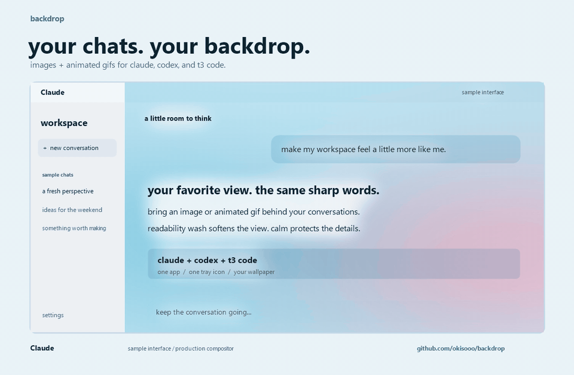
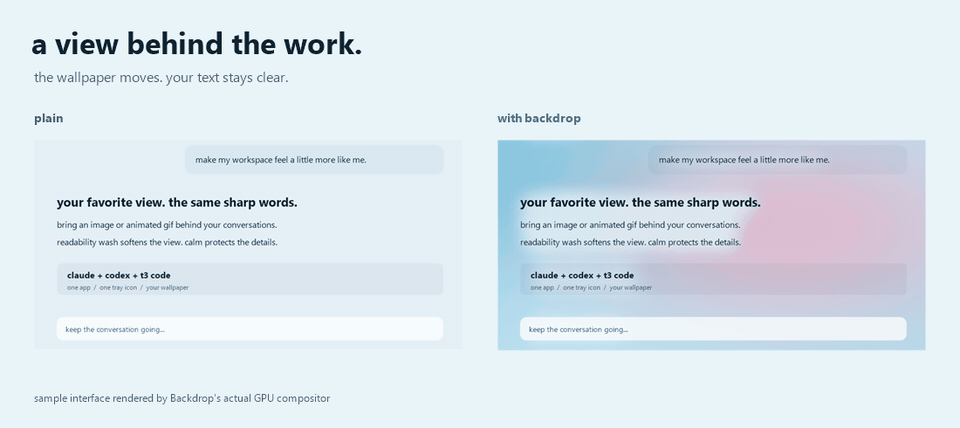

# Backdrop

**Your chats. Your backdrop.**

Put an image or animated GIF behind **Claude Desktop, Codex Desktop, and T3 Code** with one Windows tray app. Keep the words sharp. Make the view yours.

**[Download for Windows x64](https://github.com/okisooo/backdrop/releases/latest)** · [Get started](#download--run) · [Report an issue](https://github.com/okisooo/backdrop/issues)



*Demo uses invented sample interfaces rendered through Backdrop's actual GPU compositor. These are not screenshots of the three apps. No private conversations or third-party wallpaper artwork are included. [Watch the MP4](https://github.com/okisooo/backdrop/releases/latest/download/backdrop-demo.mp4).*

- **Your wallpaper:** images and animated GIFs, with cover/stretch, blur, and animation controls.
- **Your words stay readable:** readability wash softens the background; calm fades it behind text and controls.
- **Your apps stay familiar:** enable Claude, Codex, and T3 Code separately from one tray icon.
- **Your PC:** local window capture and rendering. No account, telemetry, uploads, or network service.



It does not modify any of the three apps, their files, their settings, or their network traffic.

This is the unified home of [Codex Backdrop](https://github.com/okisooo/codex-backdrop), [Claude Backdrop](https://github.com/okisooo/claude-backdrop), and T3 Backdrop: one app, one tray icon, and shared wallpaper settings for all three.

## Supported Apps

- **Claude Desktop** (`AnthropicClaude` / Windows Store `Claude_*`)
- **Codex Desktop** (`OpenAI.Codex_*`)
- **T3 Code** (`T3 Code.exe` / `T3 Code (Nightly).exe`, including custom tinted themes and SVG surface grain)

## Install

### Download & Run

1. Download **[Backdrop-win-x64.zip](https://github.com/okisooo/backdrop/releases/latest/download/Backdrop-win-x64.zip)** and extract it to a folder you want to keep.
2. Run **Backdrop.exe**. The runtime is included; no SDK, separate .NET installation, or administrator rights are needed.
3. Choose an image or animated GIF. An original sample wallpaper is included in the ZIP.
4. Right-click the tray icon to adjust **Readability wash**, **Calm behind content**, **Blur**, or the enabled apps.

Double-click the tray icon to choose another wallpaper. Enable **Start with Windows** if you want automatic startup.

Release binaries are unsigned. Each release includes a `SHA256SUMS.txt` checksum file. Backdrop bundles its runtime, so keep the app updated through [GitHub Releases](https://github.com/okisooo/backdrop/releases).

### Prerequisites

- **OS:** Windows 10 version 2004 (build 19041) or later; Windows 11 recommended (`win-x64`).
- **Portable release:** the runtime is included. A source build made without `-SelfContained` requires the [.NET 9 Desktop Runtime (x64)](https://dotnet.microsoft.com/download/dotnet/9.0).
- **To build or install from source (`.\install.ps1` / `.\build.ps1`):** the [.NET 9 SDK](https://dotnet.microsoft.com/download/dotnet/9.0).

### Build & Install from Source

```powershell
git clone https://github.com/okisooo/backdrop.git
Set-Location backdrop
.\install.ps1
```

`.\install.ps1` builds `Backdrop.exe`, installs it to `%LOCALAPPDATA%\Programs\Backdrop\Backdrop.exe`, creates a **Backdrop** Start menu shortcut, migrates any existing `CodexBackdrop` / `ClaudeBackdrop` / `T3Backdrop` configuration and startup entry, and launches the tray app. No administrator rights are needed.

- **Uninstall:** `.\uninstall.ps1` (pass `-RemoveSettings` to also delete `%LOCALAPPDATA%\Backdrop`).
- **Build only:** `.\build.ps1` (outputs a single-file executable in `artifacts\publish\Backdrop.exe`).

## Use

Backdrop lives in the Windows system tray. Right-click the tray icon for:

- **Per-app toggles (`Claude`, `Codex`, `T3 Code`)**: enable or pause each app independently and see live attachment status (`Attached (GPU)`, `Waiting for ...`, or `Paused`). The tray tooltip summarizes how many engines are currently attached.
- **Choose background…**: pick a PNG, JPG, BMP, TIFF, or animated GIF (animated GIFs play at their native frame delays). Double-clicking the tray icon also opens the file picker.
- **Readability wash**: blends the wallpaper toward each app's detected background color (`Off`, `Light`, `Medium`, `Strong`, `Very strong`) so text stays effortless to read.
- **Calm behind content**: fades the wallpaper toward the app's background color directly behind text and controls (`Off`, `Light`, `Medium`, `Strong`) while leaving open margins vibrant.
- **Blur** (`Off`, `Subtle`, `Medium`, `Strong`) and **Fit** (`Cover` or `Stretch`).
- **Animate GIFs**: play or pause GIF animation globally.
- **Wallpaper behind sidebar**: off keeps the sidebar (and Codex's Mica window frame) solid; on extends the wallpaper across the whole window.
- **Renderer**: `Automatic (GPU)` uses Direct3D 11 + DirectComposition; `CPU (compatibility)` is a software fallback.
- **Pause all**, **Start with Windows**, **Open settings folder**, and **Open log**.

Wallpaper and appearance settings are shared across all enabled apps and stored in `%LOCALAPPDATA%\Backdrop\config.json` (with logs in `%LOCALAPPDATA%\Backdrop\log.txt`).

### Upgrading from Standalone Codex / Claude / T3 Backdrop

For the portable download, first disable **Start with Windows** in your old standalone app and quit it, then run the unified Backdrop app.

On first run, Backdrop automatically imports your existing configuration (checking `%LOCALAPPDATA%\CodexBackdrop\config.json`, `%LOCALAPPDATA%\ClaudeBackdrop\config.json`, and `%LOCALAPPDATA%\T3Backdrop\config.json` in that order, including Codex Backdrop 1.x `schemaVersion` configs). Running `.\install.ps1` stops the legacy standalone processes and replaces their Start menu shortcuts and Windows startup entries with the unified `Backdrop` entry.

The unified app supports image and GIF wallpapers. Video wallpapers from the original Codex Backdrop release are not supported; choose an image or GIF when upgrading.

## How It Works

Modern desktop AI apps either block remote debugging ports or overwrite injected stylesheets on every update. Backdrop works entirely from outside the target process:

1. **Capture.** Windows Graphics Capture delivers each new frame of an attached window as a Direct3D 11 texture.
2. **Detect & Composite.** Pixel-shader passes rebuild each frame with your wallpaper behind it. Every app pixel is interpreted as ink over the app's detected background color using minimum color-to-alpha (`P + (1 - a) * (W - B)`). Text keeps its exact subpixel/grayscale anti-aliasing, and shadows or fade gradients darken the wallpaper naturally.
   - **Calm field:** At quarter resolution, each 4×4 block scores local ink contrast and spreads it with a separable Gaussian blur (~24 px). Behind dense text and UI controls, the wallpaper calms toward the app's background color; in open margins, the full wallpaper shows through.
   - **App-aware layout detection:**
     - **Codex:** Traces the rounded main content panel (`FindPanel` + corner radius measurement) so the outer Mica window frame and translucent sidebar stay untouched unless sidebar blending is enabled.
     - **Claude:** Detects the left sidebar boundary and any right-docked preview/browser pane so web previews keep their own colors.
     - **T3 Code:** Uses neighborhood-aggregated color clustering and a minimum per-channel tolerance of `4` so custom tinted themes (like `Glacier Cyan`) and T3 Code's 3.5% SVG `--surface-grain` texture key cleanly without noise speckle.
3. **Present.** Each attached app gets a click-through DirectComposition overlay window owned by the target window, sitting directly above it in Z-order. Mouse clicks, scrolling, and keyboard input pass straight through to the app.

When multiple apps are open simultaneously, decoded GIF frames are shared in memory across all active engines while each window prepares its own resolution-matched working frames.

## Performance

Measured on a 1920×1032 window actively rendering at ~55 fps with an animated GIF wallpaper:

| Mode | Engine elapsed work / render | Capture arrival to submission |
|---|---|---|
| GPU renderer | ~0.3 ms | < 1 ms |
| CPU renderer (fallback) | ~12 ms | ~12 ms |

Animation pauses when a target window is hidden, minimized, or fully covered by another window.

## Limitations

- **Single window per app:** Backdrop attaches to the largest visible main window of each enabled app. Multiple simultaneous windows of the same app are not tracked at once.
- **Taskbar & Alt-Tab thumbnails:** Windows taskbar previews, Alt-Tab, and Task View capture the underlying app window directly and therefore show the plain app without the overlay.
- **One-frame latency:** The overlay presents one display frame behind the captured window. During interactive window dragging or resizing, the overlay hides and fades back in cleanly once the drag completes.
- **Pixel-based heuristics:** Background, sidebar, dialog, and media detection work from captured pixels. Inside chat images or web previews, flat regions that match the exact theme background color will show the wallpaper. Switching themes while the sidebar is collapsed may wait until the sidebar is visible before trusting the new theme color.
- **Image & GIF wallpapers only:** Static images (`.png`, `.jpg`, `.jpeg`, `.bmp`, `.tif`, `.tiff`) and animated `.gif` files are supported; video files (`.mp4`, `.webm`) are not supported.
- **CPU fallback mode:** The CPU compatibility renderer still uses Windows Graphics Capture and a D3D11 staging readback, and does not compute the quarter-resolution calm field.

## Troubleshooting & Diagnostics

- **Open log** in the tray menu opens `%LOCALAPPDATA%\Backdrop\log.txt`, which records attachment events, detected background colors/geometries, once-a-minute render timings, and errors.
- Set `"Trace": true` in `%LOCALAPPDATA%\Backdrop\config.json` to log every visibility transition.
- **Offline snapshot diagnostic:**
  ```powershell
  Backdrop.exe --snapshot out.png [x,y,w,h] [--app claude|codex|t3] [--window 0xHWND] [--key RRGGBB]
  ```
  Captures one frame of the target app and writes `out.png` (composited output), `out.raw.png` (raw capture), and `out.calm.png` (calm field).
- **Live overlay capture:**
  ```powershell
  Backdrop.exe --capture-overlay out.png [--app claude|codex|t3]
  ```
  Captures the currently visible Backdrop overlay window on screen.

## Verification

Run the non-interactive test suite (builds the app and runs synthetic detector tests for Codex, Claude, and T3 Code, legacy v1/v2 migration checks, locator concurrency tests, and offscreen GPU/engine regression checks):

```powershell
.\tools\verify.ps1
```

Pass `-GifPath path\to\loop.gif` to also test multi-frame GIF decoding and preparation.

The engine checks also verify shared wallpaper lifetime across engines, pause/resume behavior, and clearing stale frames when a wallpaper path becomes invalid.

- Package the portable release: `.\tools\package-release.ps1 -OutputDirectory .\artifacts\release`.
- Reproduce the public media: see [demo sources and provenance](docs/media/README.md).
- Print the version without starting the tray app: `Backdrop.exe --version`.

## Privacy

Backdrop captures only the target Claude, Codex, and T3 Code windows locally in memory to composite them on your screen. Nothing is saved to disk (unless you explicitly run `--snapshot` or `--capture-overlay`) and nothing is transmitted over the network.

## Project History

Backdrop combines the standalone Codex Backdrop, Claude Backdrop, and T3 Backdrop implementations in one codebase. The published Git histories of [Codex Backdrop](https://github.com/okisooo/codex-backdrop) and [Claude Backdrop](https://github.com/okisooo/claude-backdrop) are included in this repository's `main` history; their existing issues and releases remain in the original repositories. New downloads, updates, and issue reports belong here.

## License

MIT. Not affiliated with or endorsed by Anthropic, OpenAI, or T3 Tools.
