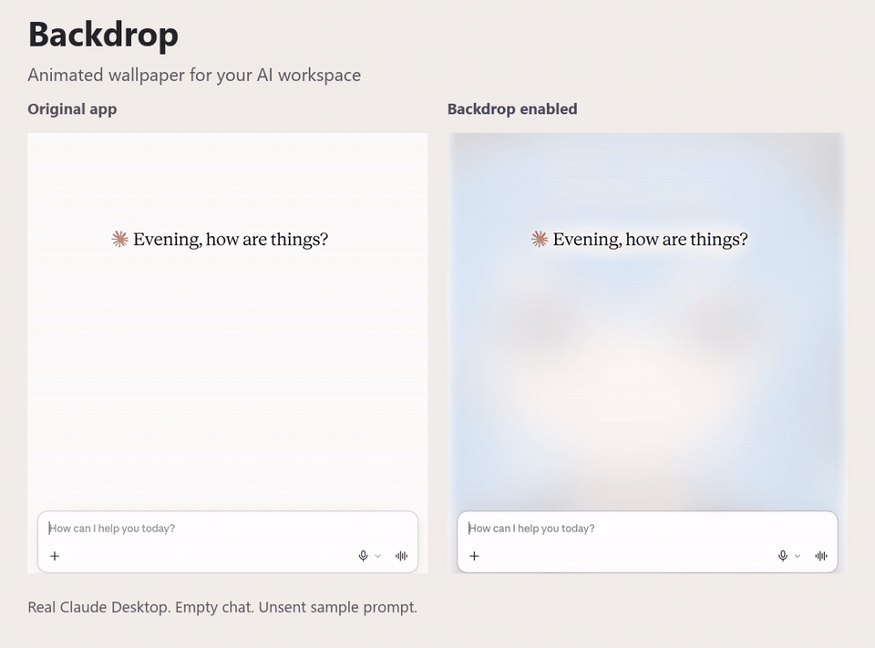

<div align="center">


# backdrop

### your wallpaper. your AI workspace.

custom backgrounds and animated GIFs for **Claude Desktop · Codex Desktop · T3 Code**.

**[download for Windows x64](https://github.com/okisooo/backdrop/releases/latest/download/Backdrop-win-x64.zip)** · [quick setup](#setup) · [settings & troubleshooting](docs/reference.md)

Windows 10 / 11 · free & open source · portable · runtime included

</div>

[](https://github.com/okisooo/backdrop/releases/download/v2.0.0/real-app-demo.mp4)

Real Claude Desktop, with a soft animated wallpaper. The demo uses an empty chat and an unsent sample prompt. **[Watch the video](https://github.com/okisooo/backdrop/releases/download/v2.0.0/real-app-demo.mp4)** · [Demo details](docs/media/README.md)

## one app for three workspaces

| app | what Backdrop adds |
| --- | --- |
| Claude Desktop | your own image or GIF behind the main chat and Code workspace |
| Codex Desktop | the same wallpaper controls for the official desktop app |
| T3 Code | wallpaper support for stable and nightly builds |

## make it yours

- **Use your own wallpaper.** Pick a still image or an animated GIF.
- **Keep text readable.** Soften the background with wash and blur; use calm to fade detail behind text and controls.
- **Control each app.** Enable Claude, Codex, and T3 Code separately from one tray icon.
- **Keep your apps as they are.** Backdrop uses a click-through overlay. It does not inject into or restart them.

## Setup

1. **[Download the ZIP](https://github.com/okisooo/backdrop/releases/latest/download/Backdrop-win-x64.zip)** and extract it to a folder you want to keep.
2. Run **Backdrop.exe** and choose an image or animated GIF. A sample wallpaper is included.
3. Open Claude Desktop, Codex Desktop, or T3 Code.

Right-click the Backdrop tray icon for settings. Double-click it to choose another wallpaper.

No SDK, separate .NET installation, account, or administrator rights are needed for the portable release. You can enable **Start with Windows** from the tray menu.

Supports Claude Desktop (including its Code workspace), the official Codex Desktop app, and T3 Code stable/nightly. Requires Windows x64, Windows 10 build 19041 or later; Windows 11 is recommended.

[Wallpaper controls and app toggles](docs/reference.md#use) · [Migration guide](docs/reference.md#upgrading-from-standalone-codex--claude--t3-backdrop)

<details>
<summary>Compatibility, privacy, and known limitations</summary>

- Releases are **unsigned**. Checksums are included with each release.
- PNG, JPG, BMP, TIFF, and animated GIF wallpapers are supported. MP4 and WebM wallpapers are not.
- One main window per app is supported.
- The overlay is one display frame behind the app and hides during window dragging or resizing.
- Alt-Tab and taskbar thumbnails show the original app without the wallpaper.
- Pixel-based detection can also tint regions of chat images that match the app's background color.
- Everything renders locally. Normal use keeps captured windows in memory and sends nothing over the network.

[Full limitations and troubleshooting](docs/reference.md#limitations)

</details>

## Upgrading from Codex / Claude / T3 Backdrop

Disable **Start with Windows** in the old standalone app, quit it, then start Backdrop. On first use, the unified app imports an existing standalone configuration. [Migration details](docs/reference.md#upgrading-from-standalone-codex--claude--t3-backdrop).

This is the shared home for all three apps. The original Codex and Claude Git histories are included in [this repository](https://github.com/okisooo/backdrop/commits/main). The superseded standalone repositories have been retired; use this project for downloads, updates, and issue reports.

## Build from source

Requires the .NET 9 SDK.

```powershell
git clone https://github.com/okisooo/backdrop.git
Set-Location backdrop
.\install.ps1
```

[Contribute](CONTRIBUTING.md) · [Verification and release tooling](docs/reference.md#verification) · [How the renderer works](docs/how-it-works.md) · [MIT license](LICENSE)

## More from OKISO

[**Fleet**](https://github.com/okisooo/fleet) puts AI usage, quotas, and reset times in one Windows 11 tray app. [**practice room**](https://github.com/okisooo/NihongoRevisionSuite) offers short language-learning rounds. [Explore more projects by OKISO](https://github.com/okisooo).

Not affiliated with or endorsed by Anthropic, OpenAI, or T3 Tools.
